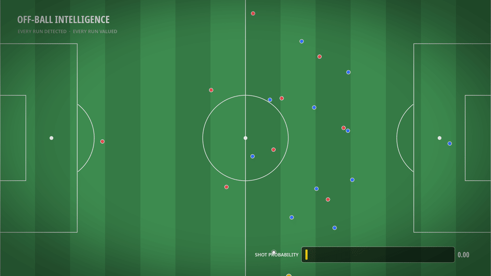
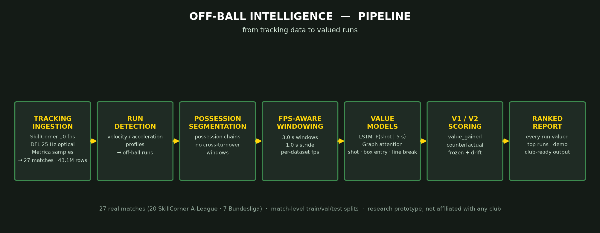

# Off-Ball Intelligence

**Quantifying football's invisible work** — an end-to-end system that watches
tracking data and prices *off-ball runs*: not goals or assists, the runs that
create them. Research prototype, not affiliated with any club.

> The code behind this project is private. This repo is the public record:
> what it does, what it found, and how to reach me.

## What it does

Seven stages, one pipeline: tracking-data ingestion → possession segmentation
→ heuristic run detection → fps-aware windowing → PyTorch value models →
counterfactual run scoring → ranked tactical report.

- **27,113 runs** detected across **27 real matches** (20 SkillCorner A-League
  + 7 DFL/Bassek Bundesliga — 43.1M tracking rows)
- **Two value models**: V1 LSTM (shot probability) and V2 per-player
  graph-attention model (shot / penalty-area entry / line break)
- **Counterfactual scoring**: every run re-scored against "what if he hadn't
  made the run?" (frozen + drift baselines)

## Results (held-out matches)

| target     | previous model | retrained on real data |
|------------|---------------:|-----------------------:|
| shot       | 0.943 | **0.953** |
| box entry  | 0.931 | **0.946** |
| line break | 0.677 | **0.812** |

The average run barely registers (mean counterfactual gain ≈ 0 — as it
should; most runs are filler). But **~9% of runs move the needle by +0.05 or
more**, and the top run in the dataset took its attack from 1% to 79% shot
probability — a run that, had the player stayed put, would have left the
attack at 1%.

## Demo

*Animated: the top-valued real-data run — away #27, 12.6 m in 2.8 s. Gold
trail = the run, dashed trail = the dragged defender, ticker = live shot
probability (0.00 → 0.78).*

## Write-up

The full technical story: [BLOG_POST.md](BLOG_POST.md) — the question, the
dataset, both models, the counterfactual analysis, honest limitations.

## Contact

Built by **Fatih Uzulmez** (UC Merced, SWE/ML). For club pilots
("give me 5 matches of tracking data, I'll send back an off-ball report"),
collaboration, or anything else: open an issue here or find me via the
portfolio site. The code is private; the results are open for discussion.
